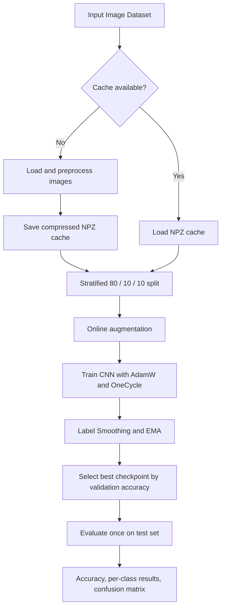
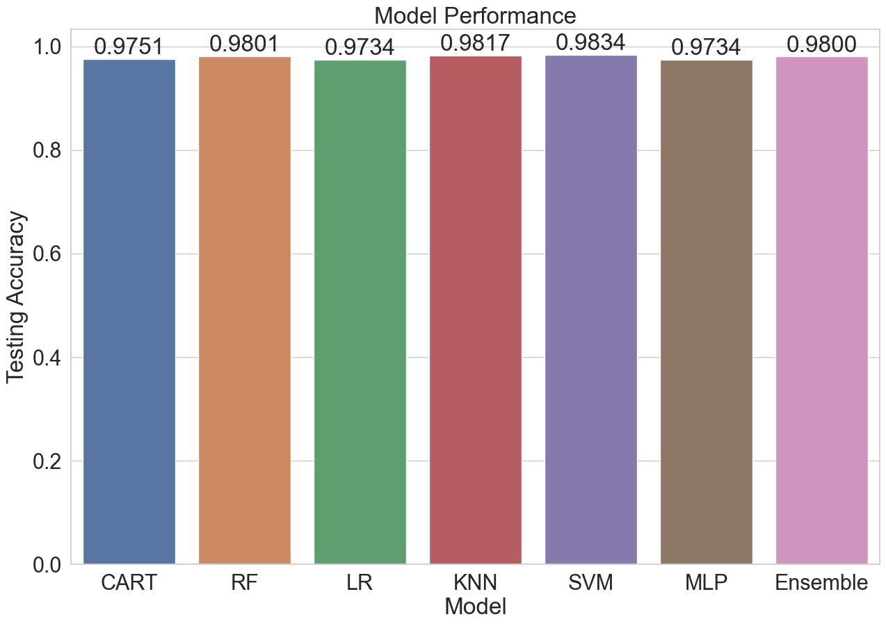
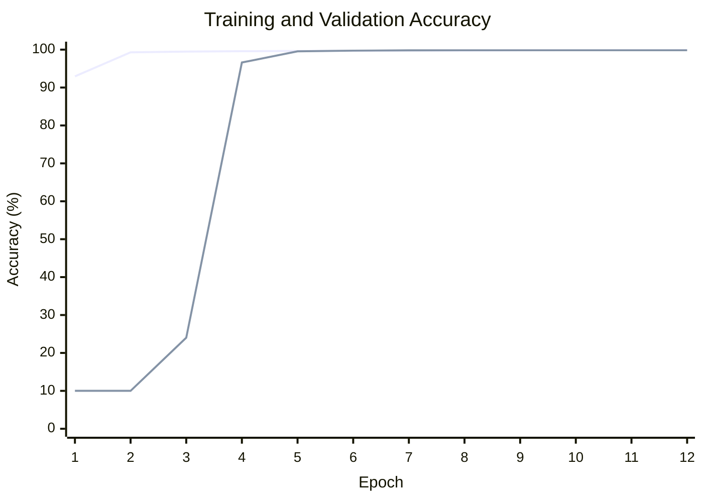
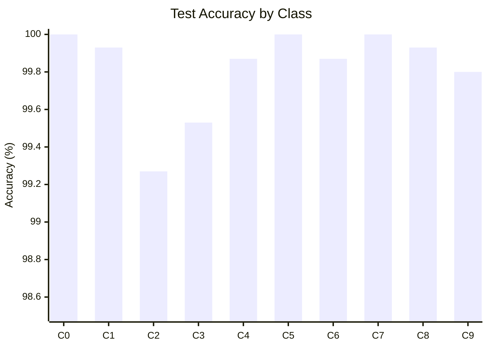

# ⚡ Lightweight CNN for Image Classification

### A compact, CPU-friendly deep learning pipeline with efficient training, online augmentation, and reliable evaluation.


:::

------------------------------------------------------------------------

## ✨ Overview

This project implements an efficient image-classification workflow built
around a **small Convolutional Neural Network (CNN)**. The model is
designed to keep computation relatively lightweight while combining
practical training techniques that can improve generalization and make
experiments easier to reproduce.

The pipeline includes on-the-fly data augmentation, modern optimization,
exponential moving average (EMA) of model weights, stratified dataset
splitting, and a reusable image cache.

## 🧠 Model Architecture

The classifier uses a compact CNN composed of:

-   **6 convolutional layers** for hierarchical visual feature
    extraction.
-   **Batch Normalization** to help stabilize and accelerate training.
-   **Global Average Pooling (GAP)** to aggregate spatial features
    without relying on a large fully connected stack.
-   A lightweight classification head for predicting the target classes.

The architecture prioritizes a practical balance between classification
performance and computational cost, making it suitable for CPU-based
experiments.

## 🛠️ Training Pipeline

  -----------------------------------------------------------------------
  Component               Method                  Purpose
  ----------------------- ----------------------- -----------------------
  Optimizer               AdamW                   Adaptive optimization
                                                  with decoupled weight
                                                  decay

  Learning-rate schedule  OneCycleLR              Dynamic learning-rate
                                                  scheduling during
                                                  training

  Regularization          Label Smoothing         Reduces over-confident
                                                  predictions

  Weight averaging        Exponential Moving      Smooths model weights
                          Average (EMA)           and may improve
                                                  validation performance

  Data augmentation       Online augmentation     Adds variation to
                                                  training images without
                                                  creating a separate
                                                  augmented dataset
  -----------------------------------------------------------------------

### 🔄 Online Data Augmentation

Each training batch receives random, mild geometric transformations:

-   **Rotation:** randomly within ±10°.
-   **Scaling:** approximately ±10%.
-   **Translation:** small horizontal and vertical shifts.

Augmentations are applied on the fly during training, helping the model
see varied samples while avoiding the need to store multiple transformed
copies of the dataset.

## 📊 Dataset Splitting & Evaluation

The dataset is divided using a **stratified 80/10/10 split**:

  Subset         Percentage Role
  ------------ ------------ --------------------------------
  Training              80% Model optimization
  Validation            10% Model selection and monitoring
  Test                  10% Final, unbiased evaluation

The best checkpoint is selected according to **validation accuracy**.
After model selection, final performance is reported on the held-out
test set.

### Evaluation Metrics

The evaluation stage reports:

-   Overall test accuracy.
-   Per-class accuracy.
-   Confusion matrix.

> **Evaluation principle:** the test set is reserved for final
> reporting; it is not used to select the best checkpoint.

## 🚀 Performance-Oriented Features

### 1. Exponential Moving Average (EMA)

EMA maintains a smoothed version of the model weights throughout
training. This can reduce the impact of noisy parameter updates and
often provides a modest improvement in validation accuracy.

### 2. Cached Dataset Loading

On the first run, processed images are saved in a compressed **`.npz`
cache file**. On subsequent runs, the pipeline can load the cached data
instead of repeating the initial image-loading and preprocessing steps.

**Why it helps:** - Faster startup after the initial cache creation. -
Less repeated preprocessing work. - A convenient reusable data
representation.

### 3. Lightweight CNN Design

The six-layer convolutional architecture, Batch Normalization, and
Global Average Pooling help keep the model compact and practical for
CPU-based training and experimentation.

## 🔬 Workflow



## ⚙️ Getting Started

### 1. Clone the repository

``` bash
git clone <YOUR_REPOSITORY_URL>
cd <YOUR_PROJECT_DIRECTORY>
```

### 2. Install dependencies

``` bash
pip install -r requirements.txt
```

### 3. Prepare the dataset

Place the dataset in the location expected by the project's data-loading
configuration. The first execution creates the compressed `.npz` cache;
later executions can reuse it.

### 4. Train and evaluate

Run the training and evaluation entry point provided in the repository.

``` bash
python <training_script>.py
```


## 📌 Reproducibility Notes

-   Keep the train, validation, and test partitions separate.
-   Select checkpoints using validation performance only.
-   Report final metrics on the held-out test partition.
-   Preserve the generated `.npz` cache when you want to avoid repeating
    initial preprocessing.
-   Record the dataset version and training configuration when comparing
    experiments.

## 🔮 Possible Future Improvements

-   Add precision, recall, and F1-score reporting.
-   Export the trained model for lightweight inference.
-   Benchmark training and inference time on CPU.
-   Compare the CNN against classical machine-learning baselines.
-   Add configurable random seeds and experiment logging.

## 🤝 Contributing

Suggestions, bug reports, and improvements are welcome. If you build on
this project, please describe your changes and include evaluation
results where possible.

## ⭐ Support

If you find this project useful, consider giving the repository a star
⭐. Feedback and contributions are always appreciated.

------------------------------------------------------------------------


**Built with 🧠 Deep Learning · ⚡ Efficient Training · 📊 Careful
Evaluation**

## 📈 Experimental Results

### Training and Validation Performance


### Confusion Matrix


### Per-Class Accuracy


The model was trained for **12 epochs** on **150,000 grayscale images**
(28 × 28 pixels) across 10 classes (`class_0`--`class_9`).

### Dataset and Model Summary

  Metric                                    Result
  ---------------------- -------------------------
  Total images                             150,000
  Image shape                              28 × 28
  Number of classes                             10
  Training samples                   120,000 (80%)
  Validation samples                  15,000 (10%)
  Test samples                        15,000 (10%)
  Model parameters                         288,170
  Training epochs                               12
  Dataset loading time                       102 s
  Saved checkpoint         `persian_digits_cnn.pt`

### Final Performance

  Metric                               Accuracy
  -------------------------------- ------------
  Best validation accuracy (EMA)     **99.83%**
  Test accuracy                      **99.82%**

The best checkpoint was selected using validation accuracy. Final
performance was then measured on the held-out test set.

### Training Progress

The chart compares training accuracy with EMA validation accuracy across
12 epochs.



`<sub>`{=html}First line: training accuracy · Second line: EMA
validation accuracy. Values are percentages.`</sub>`{=html}

  --------------------------------------------------------------------------
           Epoch  Training loss       Training     Validation     Epoch time
                                      accuracy accuracy (EMA) 
  -------------- -------------- -------------- -------------- --------------
               1         0.6173         92.95%         10.00%          258 s

               2         0.3273         99.29%         10.00%          262 s

               3         0.3161         99.48%         24.01%          260 s

               4         0.3106         99.58%         96.61%          258 s

               5         0.3076         99.64%         99.55%          257 s

               6         0.3051         99.67%         99.73%          261 s

               7         0.3030         99.73%         99.82%          265 s

               8         0.3016         99.75%         99.83%          306 s

               9         0.2996         99.80%         99.83%          292 s

              10         0.2983         99.83%         99.83%          266 s

              11         0.2973         99.86%         99.83%          287 s

              12         0.2967         99.88%         99.83%          256 s
  --------------------------------------------------------------------------

### Per-Class Test Accuracy



  Class               Correct / Total   Test accuracy
  ------------- --------------------- ---------------
  class_0                 1500 / 1500     **100.00%**
  class_1                 1499 / 1500          99.93%
  class_2                 1489 / 1500          99.27%
  class_3                 1493 / 1500          99.53%
  class_4                 1498 / 1500          99.87%
  class_5                 1500 / 1500     **100.00%**
  class_6                 1498 / 1500          99.87%
  class_7                 1500 / 1500     **100.00%**
  class_8                 1499 / 1500          99.93%
  class_9                 1497 / 1500          99.80%
  **Overall**     **14,973 / 15,000**      **99.82%**

### Confusion Matrix

Rows represent true classes and columns represent predicted classes.
Each class contains 1,500 test images.

  True  Pred.       C0     C1     C2     C3     C4     C5     C6     C7     C8     C9
  ------------- ------ ------ ------ ------ ------ ------ ------ ------ ------ ------
  **C0**          1500      0      0      0      0      0      0      0      0      0
  **C1**             0   1499      0      0      0      0      0      0      0      1
  **C2**             0      2   1489      7      2      0      0      0      0      0
  **C3**             0      0      4   1493      3      0      0      0      0      0
  **C4**             0      0      2      0   1498      0      0      0      0      0
  **C5**             0      0      0      0      0   1500      0      0      0      0
  **C6**             0      0      0      0      0      0   1498      0      0      2
  **C7**             0      0      0      0      0      0      0   1500      0      0
  **C8**             0      1      0      0      0      0      0      0   1499      0
  **C9**             0      1      0      0      0      0      2      0      0   1497

### Key Observations

-   Validation accuracy reached **96.61% at epoch 4** and exceeded
    **99.5% at epoch 5**.
-   The best validation accuracy was **99.83%**, first reached at epoch
    8.
-   The model correctly classified **14,973 of 15,000** test images,
    achieving **99.82% test accuracy**.
-   `class_2` was the most challenging class, with **99.27%** accuracy.
    Its most frequent confusion was with `class_3`.
-   `class_0`, `class_5`, and `class_7` were classified without errors
    in the test set.

### Saved Model

``` text
persian_digits_cnn.pt
```
